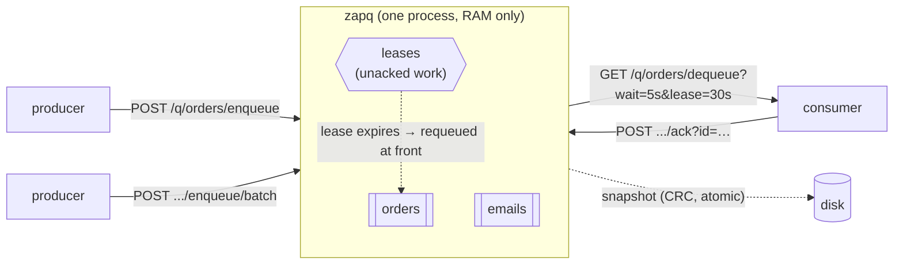

<div align="center">

# ⚡ ZapQ

**Fast in-memory FIFO message queues over plain HTTP. One static binary. Zero dependencies.**

[](https://github.com/raiyanyahya/zapq/actions/workflows/release.yml)
[](https://github.com/raiyanyahya/zapq/actions/workflows/codeql.yml)
[](https://scorecard.dev/viewer/?uri=github.com/raiyanyahya/zapq)
[](https://goreportcard.com/report/github.com/raiyanyahya/zapq)
[](https://pkg.go.dev/github.com/raiyanyahya/zapq/client)
[](go.mod)
[](https://github.com/raiyanyahya/zapq/releases)
[](https://github.com/raiyanyahya/zapq/pkgs/container/zapq)
[](LICENSE)

[Quick start](#-quick-start) · [API](#-api) · [Delivery semantics](#-delivery-semantics) · [Configuration](#-configuration) · [Monitoring](#-monitoring) · [Benchmarks](#-benchmarks) · [Deployment](#-deployment) · [FAQ](#-when-should-i-not-use-zapq)

</div>

---

ZapQ is a small Go server that gives you fast FIFO message queues over HTTP. You push bytes in and pull them out in the same order. There is no config file, no external database and no clustering. It runs as a single static binary, uses only RAM, and the entire server plus its Go client build from the standard library alone.

Each queue is a pre-allocated ring buffer behind a read-write mutex. Enqueue and dequeue are O(1) at every scale — no slice shifts, no growing arrays, no hidden work that gets slower over time. The queue operates in nanoseconds; your network is the slow part, which is what batching is for.



## ✨ Features

- **Named queues** — `/q/orders/enqueue`, created on first use, each with its own caps and metrics
- **At-least-once delivery** — dequeue with a lease (`?lease=30s`), ack when done; unacked messages are redelivered
- **Batching** — enqueue/dequeue up to 1000 messages per request, all-or-nothing on the enqueue side
- **Binary TCP protocol** (`--tcp-addr`) — a pipelined wire format for hot paths: 13µs round trips, millions of msg/s per connection ([spec](docs/PROTOCOL.md))
- **Long-poll dequeue** (`?wait=5s`) so consumers don't busy-poll, with backpressure on parked waiters
- **Scoped bearer tokens** — separate producer / consumer / admin credentials, constant-time compared
- **Prometheus + JSON metrics** from one `/metrics` endpoint, including per-queue head-of-line message age
- **Snapshots** — CRC-checked binary format; restored on start, written on shutdown, optionally on an interval
- **Official Go client** with retries and jittered backoff · **[OpenAPI spec](openapi.yaml)** for every other language
- Structured JSON logs with per-request trace IDs, graceful shutdown, TLS, optional pprof
- `FROM scratch` container (no OS packages, self-probing healthcheck), cosign-signed releases, SBOM

## 🚀 Quick start

Grab a [release binary](https://github.com/raiyanyahya/zapq/releases), pull the container, or build from source:

```bash
go build -o zapq . && ./zapq              # source (Go 1.22+)
docker run --rm -p 8080:8080 ghcr.io/raiyanyahya/zapq:latest   # container
```

Push and pull:

```bash
curl -X POST localhost:8080/q/orders/enqueue -d 'job-1'
curl "localhost:8080/q/orders/dequeue?wait=5s"       # long-poll up to 5s
```

At-least-once consumption with a lease:

```bash
curl -D- "localhost:8080/q/orders/dequeue?lease=30s"   # note the X-Lease-Id header
# ...do the work...
curl -X POST "localhost:8080/q/orders/ack?id=<lease-id>"
# crash instead of acking? the message is requeued when the lease expires
```

Or from Go:

```go
import "github.com/raiyanyahya/zapq/client"

c := client.New("http://localhost:8080", client.WithToken(token))
_ = c.Enqueue(ctx, "orders", []byte("job-1"))

msg, ok, _ := c.DequeueLease(ctx, "orders", 5*time.Second, 30*time.Second)
if ok {
    process(msg.Data)
    _ = c.Ack(ctx, "orders", msg.LeaseID)
}
```

When the queue is on your hot path, skip HTTP entirely — start the server with `--tcp-addr :6789` and use the binary protocol (same queues, same tokens, ~3× lower latency):

```go
t, _ := client.DialTCP("localhost:6789", client.TCPAuth(token))
_ = t.Enqueue("orders", []byte("job-1"))
msg, ok, _ := t.Dequeue("orders", 5*time.Second, 30*time.Second)
if ok { _ = t.Ack("orders", msg.LeaseID) }
```

## 📡 API

Full contract in [`openapi.yaml`](openapi.yaml). Paths without a `/q/{queue}/` prefix operate on the queue named `default`.

| Endpoint | What it does |
|----------|--------------|
| `POST /q/{queue}/enqueue` | Push one message. `202`, or `413` over the per-message cap, or `429` + `Retry-After` when full |
| `GET /q/{queue}/dequeue` | Pop the next message: `200` with raw bytes, `204` when empty. Takes `wait` and `lease` |
| `POST /q/{queue}/ack?id=` | Settle a lease. `404` if it already expired (the work is being redelivered) |
| `POST /q/{queue}/enqueue/batch` | Up to 1000 messages in one request, accepted whole or not at all |
| `GET /q/{queue}/dequeue/batch?max=` | Up to `max` messages in one response; lease IDs in `X-Lease-Ids` |
| `POST /q/{queue}/clear` | Drop everything including outstanding leases *(admin)* |
| `GET /queues` | List queues with length, bytes, leases and head age |
| `GET /metrics` | JSON by default, Prometheus text when the scraper asks |
| `POST /persist` / `POST /load` | Snapshot all queues to/from the data directory *(admin)* |
| `GET /health` / `GET /version` | Probes; never require auth |

Details worth knowing:

- `?wait=5s` long-polls until a message arrives (capped at 20s). Parked waiters are capped by `--max-waiters`; beyond that you get `503` + `Retry-After` instead of a goroutine pile-up.
- `?lease=30s` delivers under a lease: the response carries `X-Lease-Id` and `X-Lease-Expires`. Ack in time or the message is requeued **at the front** and `zapq_lease_expirations_total` ticks up.
- Batch bodies use a trivial framing — 4-byte big-endian length + payload, repeated (`application/vnd.zapq.frames`). The HTTP round trip dominates single-message latency; batching is the throughput lever.
- Every response carries `X-Trace-Id` (or echoes yours), and the same ID appears in the server's JSON logs.

## 📬 Delivery semantics

Be deliberate about which mode you use:

| Mode | Guarantee | Failure behavior |
|------|-----------|------------------|
| Plain dequeue | At-most-once | Consumer crash after receive ⇒ message lost |
| Lease + ack | At-least-once | Crash ⇒ redelivered after lease expiry; make handlers idempotent |
| Enqueue with retries | At-least-once | Lost response + retry ⇒ possible duplicate; dedupe downstream if it matters |

A `kill -9` loses whatever wasn't snapshotted; snapshots bound the loss window to `--snapshot-interval`. Graceful shutdown (SIGTERM) always writes a final snapshot first.

## ⚙️ Configuration

Flags beat environment variables; invalid values fail fast at startup.

| Flag | Env | Default | What it does |
|------|-----|---------|--------------|
| `--addr` | | `:8080` | HTTP listen address |
| `--tcp-addr` | | off | Binary protocol listen address, e.g. `:6789` ([spec](docs/PROTOCOL.md)) |
| `--max-bytes` | `QUEUE_MAX_BYTES` | `256M` | Per-queue memory cap (`K`/`M`/`G` suffixes) |
| `--max-msgs` | `QUEUE_MAX_MSGS` | `50000` | Per-queue message cap |
| `--max-msg-bytes` | `ZAPQ_MAX_MSG_BYTES` | `128K` | Per-message size cap |
| `--max-queues` | | `64` | Maximum number of named queues |
| `--max-waiters` | | `1024` | Maximum concurrently parked long-poll requests |
| `--max-lease` | | `5m` | Longest allowed lease duration |
| `--data-dir` | | `.` | Directory for snapshots and persist/load |
| `--api-token` | `ZAPQ_API_TOKEN` | | Token with full access |
| `--producer-token` | `ZAPQ_PRODUCER_TOKEN` | | Enqueue + metrics only |
| `--consumer-token` | `ZAPQ_CONSUMER_TOKEN` | | Dequeue/ack + metrics only |
| `--admin-token` | `ZAPQ_ADMIN_TOKEN` | | Everything incl. clear/persist/load |
| `--log-level` | `ZAPQ_LOG_LEVEL` | `info` | `debug`, `info`, `warn`, `error` |
| `--snapshot-file` | `ZAPQ_SNAPSHOT_FILE` | | Load on start, persist on shutdown |
| `--snapshot-interval` | `ZAPQ_SNAPSHOT_INTERVAL` | | Also persist periodically, e.g. `30s` |
| `--tls-cert` / `--tls-key` | | | HTTPS |
| `--pprof` | | off | `/debug/pprof` *(admin)* |
| `--healthcheck` | | | Probe the local server and exit 0/1 |

Prefer env vars for tokens so they don't show up in `ps`. Setting any one token enforces auth everywhere except `/health` and `/version`. `GOMEMLIMIT` is respected and suggested at startup if unset.

## 💾 Durability

```bash
./zapq --data-dir /var/lib/zapq --snapshot-file zapq.snap --snapshot-interval 30s
```

Snapshots cover **all** queues and include unacked leased messages, which come back as visible work after a restore. The format is binary with a version magic and CRC32 trailer, written atomically (temp file → fsync → rename). Corruption is detected at load and the server refuses to start rather than silently dropping data — delete the file to start empty. Message age survives snapshots, so head-age alerts stay truthful across restarts. Legacy JSON snapshots from older versions still load.

## 📊 Monitoring

```bash
curl localhost:8080/metrics                          # JSON
curl -H 'Accept: text/plain' localhost:8080/metrics  # Prometheus (scrapers get this automatically)
```

The three alerts worth having:

| Alert on | Meaning |
|----------|---------|
| `zapq_head_message_age_seconds{queue=...}` growing | Consumers are behind — the queue-latency signal that actually matters |
| `zapq_queue_msg_bytes` → `--max-bytes` | Producers are about to see 429s |
| `zapq_lease_expirations_total` climbing | Consumers are dying or too slow mid-work |

Aggregate series (`zapq_enqueues_total`, `zapq_queue_length`, `zapq_waiting_consumers`, ...) and per-queue labeled series are both exposed.

## 🏁 Benchmarks

Environment: AMD Ryzen AI 7 350 (16 threads), Go 1.26, Linux, loopback HTTP, 128-byte payloads. Every load-test run verifies zero message loss. Numbers below are medians of repeated runs; loopback removes network RTT, so treat the HTTP figures as the server-side ceiling.

**Queue engine** (`make bench` — no HTTP, just the data structure):

| Operation | Time | Allocations |
|-----------|------|-------------|
| Enqueue | 32 ns | 1 (payload copy) |
| Dequeue | 18 ns | 0 |
| Enqueue (parallel ×16) | 147 ns | 1 |
| Dequeue (parallel ×16) | 105 ns | 0 |
| Enqueue → dequeue round trip | 140 ns | 1 |
| Batch enqueue, per message (100/batch) | 36 ns | 1 |
| Lease + ack round trip | 180 ns | 2 |
| Read length and size (parallel) | 55 ns | 0 |

**End-to-end HTTP** (real server process, real sockets):

| Scenario | Result |
|----------|--------|
| Single-message enqueue, 200 concurrent producers | **183,000 msg/s** |
| Single-message dequeue, 200 concurrent consumers | **173,000 msg/s** |
| Round-trip latency, sequential single connection | **p50 46 µs** · p95 86 µs · p99 140 µs |
| Batch enqueue (500 msgs/request, 4 workers) | **5.1–7.2M msg/s** |
| Batch dequeue (500 msgs/request, 4 workers) | **7.3–7.5M msg/s** |

**Binary TCP protocol** (`--tcp-addr`, single connection, individual messages — no batching):

| Scenario | Result |
|----------|--------|
| Round-trip latency, sequential | **p50 13 µs** · p95 19 µs · p99 27 µs |
| Pipelined enqueue | **2.0–2.2M msg/s** |
| Pipelined dequeue | **3.3M msg/s** |

The story in three numbers: the queue does an operation in 32ns, HTTP delivers 183k single messages per second, and the same messages over the binary protocol move at 2M+/s on *one connection* with 3.5× lower latency. HTTP overhead — not the queue — is the bottleneck, so zapq gives you two ways out: batch over HTTP (7M msg/s) or drop to TCP (13µs round trips). Both verified lossless on every run.

Reproduce it:

```bash
make bench                                    # queue engine
./zapq --addr :8080 --tcp-addr :6789 \
       --max-msgs 300000 --max-bytes 1G       # then, in another shell:
go run ./loadtest -addr http://127.0.0.1:8080 \
    -messages 200000 -producers 200 -consumers 200 -payload 128
```

## 🚢 Deployment

- **systemd** — [`deploy/systemd/zapq.service`](deploy/systemd/zapq.service): hardened unit with `DynamicUser`, state directory and snapshot restore on restart.
- **Kubernetes** — [`deploy/kubernetes/zapq.yaml`](deploy/kubernetes/zapq.yaml): single-replica Deployment with probes, resource limits, Prometheus annotations and a token Secret. Keep `replicas: 1` — multiple replicas are independent queues and break global FIFO order.
- **Docker** — the image is `FROM scratch` (zero packages, zero shell), runs as UID 10001 with a `/data` volume, and healthchecks itself via `zapq --healthcheck`. Images and release checksums are cosign-signed (keyless); an SPDX SBOM ships with every release — verification steps in [SECURITY.md](SECURITY.md).

On Linux raise your file descriptor limit for heavy loads: `ulimit -n 65535` (the systemd unit does this for you).

## 🤔 When should I *not* use ZapQ?

Honest answers, because picking the right tool matters more than adopting this one:

| You need | Use instead |
|----------|-------------|
| Replication / survives node loss | Kafka, NATS JetStream |
| Consumer groups, partitions, replay | Kafka, Redpanda |
| Exactly-once processing | Kafka transactions + idempotent sinks |
| A managed service | SQS, Pub/Sub |
| Rich data structures next to your queue | Redis |

ZapQ's niche: a fast, operationally boring work queue **next to** your service — one binary, one port, nothing to cluster. Sub-microsecond queue ops, at-least-once when you ask for it, and honest limits everywhere else.

## 🔧 How it works

Each queue is a fixed-size ring buffer of `(payload, enqueue-time)` pairs behind a read-write mutex; per-queue counters are atomics outside the lock. Enqueue copies the payload into the tail slot; dequeue clears the head slot for the GC and advances. Batches move under a single lock acquisition.

Leased messages leave the ring but keep counting against the capacity and byte caps, so an expiring lease can always requeue at the head — a full queue can never strand a retry. A reaper sweeps expired leases every second.

Long-poll consumers park on a notification channel; each enqueue wakes one waiter, and a waiter that finds more messages behind its own passes the wakeup along.

The binary TCP listener shares everything with HTTP — queues, token scopes, limits, metrics — it only swaps the wire. Requests are 15-byte headers plus payload, responses return in order, and the server holds its write buffer open while pipelined requests are still arriving, so a flooding client amortizes both syscalls and flushes.

Snapshots are taken under a read lock (payloads are immutable once enqueued) so queues keep serving during persistence.

## 🛠 Development

```bash
make test       # race detector + coverage
make bench      # queue benchmarks
make lint       # staticcheck
make fuzz       # native Go fuzzing, short run
make vulncheck  # govulncheck
```

CI runs formatting, vet, staticcheck, govulncheck, race-enabled tests on current **and** previous Go (with a coverage report per run), short fuzz sessions, a benchmark sanity pass and a Docker build check on every push and PR. CodeQL and OpenSSF Scorecard run on their own workflows; Dependabot watches Actions, Go modules and the Dockerfile. Tags build binaries for linux/darwin on amd64/arm64 and publish a signed multi-arch image to GHCR with checksums, signatures and an SBOM attached to the release.

Contributions welcome — see [CONTRIBUTING.md](CONTRIBUTING.md). Security reports: [SECURITY.md](SECURITY.md).

## 📄 License

[MIT](LICENSE)
